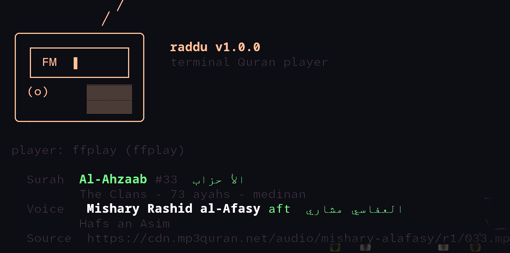

# raddu

**رَدْدُ — a terminal Quran player with per-reciter voice codes.**



Pick a surah, pick a voice, press enter. `raddu` streams the recitation
straight to your audio player. Every reciter has a short code, every surah
has a short code, and `raddu -h` lists all of them.

```
raddu -baqara -sud        # Surah Al-Baqara, recited by Abdur-Rahman as-Sudais
raddu -r sud              # a random surah, in the voice of as-Sudais
```

No account, no ads, no download page, no browser. Just audio.

---

## What this is (and is not)

This is a thin, honest transport tool:

* It plays **the original recorded recitation** of the Quran, exactly as
  recorded by the reciter.
* It performs **no text-to-speech, no voice cloning, no re-recitation, and no
  AI of any kind.** Nothing is generated, synthesised, or modified.
* The text, the reciters, and the surah metadata come from the public
  [alquran.cloud](https://alquran.cloud), [mp3quran.net](https://mp3quran.net)
  and [Way2Quran](https://way2quran.com) APIs; the audio is served by
  mp3quran.net and Way2Quran's own CDN.
* Each surah is served as **one continuous MP3**, so there are no gaps and no
  stitched-ayah seams.
* Pure Python standard library — **zero dependencies**, nothing to `pip install`.

---

## Install

Requires Python 3.10+ and any one audio player (`mpv` recommended).

```bash
git clone <this-repo> ~/raddu
cd ~/raddu
./install.sh
```

`install.sh` symlinks `raddu` into `~/.local/bin`. Add it to your `PATH` if
needed:

```bash
export PATH="$HOME/.local/bin:$PATH"
```

You can also run it straight from the source tree without installing:

```bash
./bin/raddu -baqara -sud
```

### Audio player

`raddu` does not decode audio itself — it pipes the stream into a real player.
Auto-detected, in this order:

| player | streams | note |
|---|---|---|
| `mpv` | yes | recommended, gapless, light |
| `ffplay` | yes | ships with ffmpeg |
| `mpg123` | yes | lightest option |
| `cvlc` / `vlc` | yes | VLC |
| `mplayer` | yes | mplayer |
| `afplay` | no (temp file) | macOS |
| `paplay` | no (temp file) | PulseAudio |
| `mpg321` | yes | minimal mp3 player |

```bash
sudo apt install mpv       # or: mpg123
raddu --list-players       # see what was detected
raddu -naas --player mpg123
```

---

## Usage

```
raddu [surah] [voice] [options]
```

### Selecting a surah

Any of these work:

```bash
raddu -baqara            # by code
raddu 2                  # by number
raddu --surah 2          # long form
raddu --surah baqara     # long form, by name
raddu -fatiha -baqara    # several surahs = a playlist
```

`raddu -h` prints all 114 codes, and `raddu -s` prints the full table with
ayah counts.

### Selecting a voice

Every reciter has a short code. `sud` is as-Sudais, `aft` is al-Afasy, and so on.

```bash
raddu -baqara -sud           # bare code
raddu -baqara --reciter sud  # long form
raddu -r sud                 # random surah, as-Sudais
```

Longer aliases work too — `-sudais`, `-as-sudais`, `-abdulrahman` all resolve
to the same voice.

### Random

```bash
raddu                        # random surah, your saved/default voice
raddu -r                     # random surah
raddu -r sud                 # random surah, as-Sudais
raddu -r -n 5 -aft           # 5 random surahs in al-Afasy's voice
raddu -r -n 3 --seed 42      # reproducible
```

### Playlists

Give several surahs and several voices; the voices cycle through the list.

```bash
raddu -baqara -yaseen -aft -shr    # Baqara (Al-Afasy), then Yaseen (ash-Shuraim)
raddu -1 -10 -20 -30 -sud -hus     # four short surahs, two voices
```

### Recitation styles (riwaya)

Several reciters have more than one recording. Append `:style` to the voice.

```bash
raddu -yaseen -hus:mujawwad    # al-Husary, Mujawwad
raddu -yaseen -hus:qalun       # al-Husary, Qalun an Nafi
raddu -yaseen -hus             # the default (Hafs an Asim, Murattal)
raddu -yaseen --style warsh    # applies to whichever voice is selected
```

If a style does not contain the surah you asked for, `raddu` says so and
lists the styles that do — rather than failing with a 404.

### Offline voices & saving

Install any voice or surah offline so you can play without an internet connection:

```bash
raddu -d sud                  # install the full voice (all 114 surahs) for as-Sudais
raddu -d                      # install all 114 surahs for your default voice
raddu -baqara -sud -d         # save Surah Al-Baqara offline for as-Sudais
raddu --offline-list          # list all voices and surahs installed offline
raddu --offline -baqara -sud  # play strictly from offline storage (no network)
raddu --remove-voice sud      # remove downloaded audio for a voice
```

When you use `raddu` normally (e.g. `raddu -baqara -sud`), if the audio is already downloaded offline, `raddu` plays directly from your local disk with zero network latency and no buffering.

To export audio to a specific folder instead of the offline library, pass the folder path:

```bash
raddu -baqara -sud --download ~/Music/Quran/
```

---

## The voices

| code | reciter | default | alternates |
|---|---|---|---|
| `sud` | Abdur-Rahman as-Sudais | Hafs an Asim | — |
| `hus` | Mahmoud Khalil al-Husary | Hafs an Asim | mujawwad, qalun, warsh, doori |
| `abs` | Abdul Basit Abdus-Samad | Mujawwad | hafs, warsh |
| `shr` | Saud ash-Shuraim | Hafs an Asim | — |
| `aft` | Mishary Rashid al-Afasy | Hafs an Asim | kisaai |
| `sha` | Abu Bakr ash-Shatri | Hafs an Asim | — |
| `min` | Muhammad Siddiq al-Minshawi | Mujawwad | hafs, archive |
| `mui` | Maher al-Muaiqly | Mujawwad | hafs |
| `ajm` | Ahmad ibn Ali al-Ajmī | Hafs an Asim | — |
| `hud` | Ali Abdur-Rahman al-Hudhaify | Hafs an Asim | qalun, shubah |
| `haz` | Hazzaa al-Balushi | Hafs an Asim | 91/114 — see below |
| `luh` | Muhammad al-Luhaidan | Hafs an Asim | — |
| `kha` | Mohammad Khalil al-Qari | Hafs an Asim | — |

### Mauritanian voices

Seven voices from Mauritania, all with the complete 114-surah mushaf. These
come from [Way2Quran](https://way2quran.com), which tags every reciter with a
country — so unlike everywhere else the nationality is **published, not
guessed**. Each carries `nationality: MR` and `raddu -f mauritanian` finds
them all.

| code | reciter | riwāyah | |
|---|---|---|---|
| `bilal` | Al-Nagy Ould Bilal | Qalun an Nafi | 🇲🇷 114/114 |
| `slmz` | Mohamed Salem Ould Zine | Qalun an Nafi | 🇲🇷 114/114 |
| `lagh` | Mohamed Laghzaf Ould Mohamed Sidi | Qalun an Nafi | 🇲🇷 114/114 |
| `shkh` | Sheikhna Ould Al-Hajj | Qalun an Nafi | 🇲🇷 114/114 |
| `ragl` | Alragel Ould Othman | Warsh an Nafi | 🇲🇷 114/114 |
| `hsan` | Al-Hassan Ould Habib Allah | Qalun an Nafi | 🇲🇷 114/114 |
| `mrdo` | Muhammad Al-Rady Ould Amlyeh | Qalun an Nafi | 🇲🇷 114/114 |

```bash
raddu -baqara -bilal          # Al-Baqara, Al-Nagy Ould Bilal
raddu -f mauritanian          # list them
```

Two more Mauritanian reciters are on Way2Quran but do not cover the whole
mushaf, so they are not offered: Mohamed Ould El Salik (22/114) and Mohammed
Yahya Al Shanqeeti (92/114).

Way2Quran does not zero-pad its filenames consistently — `001.mp3` exists but
`002.mp3` does not, while `2.mp3` exists but `1.mp3` does not. `raddu`
therefore scrapes the exact filename per surah with
`tools/scrape_way2quran.py` instead of constructing a URL.

### Incomplete recordings

Some reciters do not have all 114 surahs recorded. `raddu` tracks this per
recitation and tells you plainly instead of failing with a 404:

```
$ raddu -baqara -haz
raddu: Hazzaa al-Balushi does not have Surah Al-Baqara in the Hafs an Asim
recording (available 91/114; missing 2, 3, 4, 5, 7, 9 ...). Hazzaa al-Balushi
has no other recording - see 'raddu -R' for a reciter that covers all 114.
```

`haz` is the only one with gaps today (surahs 2, 3, 4, 5, 7, 9, 10, 11, 16, 23,
24, 26, 27, 28, 33, 48, 56, 58, 59, 60, 62, 64, 65, 66 are absent upstream).

### Choosing a default voice

The default voice is `aft`. Change it:

```bash
raddu --set reciter=hus
raddu --config
raddu --set reciter=clear      # back to the built-in default
```

---

## All options

### Selection

| option | meaning |
|---|---|
| `-r`, `--random [VOICE]` | play a random surah, optionally in the given voice |
| `-n`, `--count N` | play N random surahs |
| `--surah SURAH` | surah by name or number (repeatable) |
| `--reciter VOICE` | voice code, or `code:style` (repeatable) |
| `--style STYLE` | recitation style: `hafs`, `mujawwad`, `warsh`, `qalun`, … |

### Information

| option | meaning |
|---|---|
| `-s`, `--list-surahs` | list all 114 surahs with their codes |
| `-R`, `--list-reciters` | list all voices with their codes |
| `-f`, `--find TEXT` | search surahs and voices by name |
| `--check [VOICE]` | verify audio is reachable (plays nothing) |
| `--list-players` | show which audio players were found |
| `-h`, `--help` | help, including every voice and surah code |

### Offline & Downloads

| option | meaning |
|---|---|
| `-d`, `--download [VOICE\|DIR]` | save voice or surah(s) offline (or export to `DIR`) |
| `--offline` | play strictly from offline storage (never use network) |
| `--offline-list` | list voices and surahs installed offline |
| `--remove-voice VOICE` | remove an offline installed voice |

### Output

| option | meaning |
|---|---|
| `--url` | print the resolved URL(s) and exit |
| `--json` | print the resolved plan as JSON and exit |
| `--player NAME` | force a specific audio player |
| `--timeout SEC` | network timeout (default 45) |
| `--no-banner` | suppress the header and per-track details |
| `--seed N` | seed the random choice |

`--url` and `--json` write **only** machine-readable output to stdout
(banners and warnings go to stderr), so they pipe cleanly:

```bash
raddu -baqara -sud --url | xargs -I{} mpv {}
raddu -r -n 10 -aft --json | jq -r '.[].slug'
```

---

## Configuration

Settings live in `~/.config/raddu/config.json` (respects `XDG_CONFIG_HOME`).

```bash
raddu --set reciter=sud
raddu --set style=hafs
raddu --set player=mpv
raddu --set storage=~/.local/share/raddu/voices   # custom offline storage path
raddu --config
```

---

## Troubleshooting

**"no audio player found on PATH"**
Install one: `sudo apt install mpv`. Check with `raddu --list-players`.

**Nothing happens / it exits immediately**
On a headless or SSH session you need an audio device or a remote sink. For
SSH, forward audio or use `paplay` with a PulseAudio server.

**A voice won't play**
Run `raddu --check` to verify every voice, or `raddu --check sud` to verify
one. It prints the size the CDN reports for each URL and never plays sound.

**Slow connection**
`raddu` streams, it does not buffer the whole file first, so playback starts
almost immediately. Raise `--timeout` on a very slow link.

**Behind a SOCKS proxy**
`urllib` cannot speak SOCKS. `raddu` detects a `socks5://` proxy in the
environment, bypasses it, and says so. Install PySocks if you need it.

**Ctrl-C does nothing**
It should not — this was a real bug and is fixed. If you hit it, you are on
an old copy; `Ctrl-C` during a long surah now exits cleanly and reaps the
player process.

---

## Project layout

```
bin/raddu              launcher (stdlib-only entry point)
install.sh             symlink into ~/.local/bin
src/raddu/
  cli.py               argument parsing, planning, dispatch
  catalog.py           surah/reciter lookup and URL resolution
  data/surahs.json     114 surahs + 448 aliases
  data/reciters.json   20 voices + 32 recitation styles
  net.py               HTTP streaming and probing
  player.py            player detection and playback
  ui.py                colours, tables, progress bar
  config.py            ~/.config/raddu/config.json
tools/sync_catalog.py  regenerates the JSON data from the upstream APIs
tools/scrape_way2quran.py  caches Way2Quran reciter pages (nationality + filenames)
tools/cache/           raw upstream API dumps
tests/smoke.sh         offline + online smoke tests
```

### Regenerating the catalog

The shipped JSON is generated, never hand-edited:

```bash
python3 tools/sync_catalog.py --refresh   # re-download upstream, rebuild JSON
python3 tools/sync_catalog.py             # rebuild from tools/cache/
```

To add more voices, add an entry to `RECITERS` in `tools/sync_catalog.py`
using a reciter/moshaf id from
`https://mp3quran.net/api/v3/reciters?language=ar`, then re-run the script.

---

## Tests

```bash
tests/smoke.sh              # full suite
tests/smoke.sh --offline    # skip network tests
```

---

## Credits

* Recitation audio and surah listings: [mp3quran.net](https://mp3quran.net),
  [Way2Quran](https://way2quran.com)
* Surah metadata: [alquran.cloud](https://alquran.cloud)
* Credit goes to every reciter named above, and to the many people who
  recorded, digitised and hosted these recitations. May it be accepted.